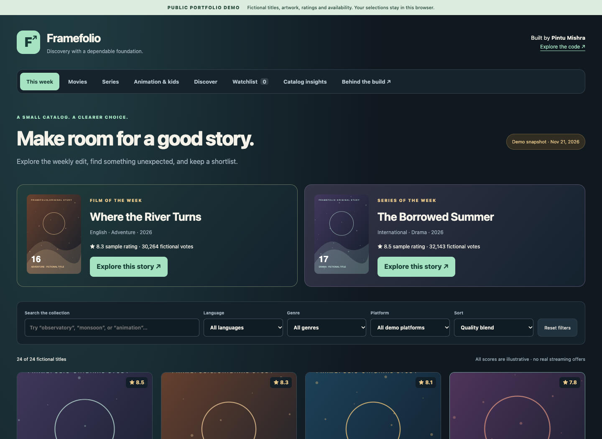

# Framefolio · movie-discovery engineering showcase

A navigable public edition of a personal movie-discovery product, prepared by **Pintu Mishra** so reviewers can explore the experience and inspect the implementation without access to the private app.

**[Open the demo](https://pmishra143.github.io/movies-portfolio-showcase/)** · [Architecture](docs/ARCHITECTURE.md) · [Source provenance](docs/PROVENANCE.md) · [Operating guide](docs/OPERATING-GUIDE.md)



## Try it in two minutes

1. Browse **This week**, then switch between **Movies**, **Series**, and **Animation & kids**.
2. In **Discover**, search for `monsoon`, combine filters, and open a title to inspect its score and fictional availability.
3. Save a title and visit **Watchlist**. Refresh the browser: the selection stays locally, with no user account or server write.
4. Open **Catalog insights** for computed catalog counts and an explanation of the ranking formula.
5. Open **Behind the build** and run the **failed refresh simulation**. Browse again: the loaded snapshot remains available with a visible degraded-state notice. Restore the demo state when finished.

All 24 titles, descriptions, scores, platform availability and SVG artwork are original fictional fixtures. No IMDb/Rotten Tomatoes scores, provider artwork, streaming links, private watch history or family photos are redistributed. This is a discovery demonstration, not a streaming service or Disney-affiliated product.

## What is original-app work, and what is new?

The private application has movie/series discovery, scheduled ingestion and enrichment, catalog caching, preferences, and additional companion sections. Its source was inspected to understand the workflow. This repo is a **new, focused public implementation**, not the complete production source or a mirror of a private monorepo.

The quality-ranking formula is adapted from the original browser code. The public UI, fictional fixture generator, contract validation, atomic snapshot pipeline, tests and operating documentation were written for this showcase. See [PROVENANCE.md](docs/PROVENANCE.md) for source hashes and precise boundaries.

No production uptime, user-volume, latency, recommendation-quality or incident-reduction result is claimed. The failure exercise is a local UI simulation; the pipeline's last-known-good preservation is separately verified by executable tests.

## Run locally

Requires Python 3.10+ and Node.js 20+. The app and unit tests have **no third-party runtime dependencies**.

```bash
python3 -m http.server 8000 --directory docs --bind 127.0.0.1
```

Open `http://127.0.0.1:8000`. Serve over HTTP; opening `index.html` as a `file:` URL will not load the JSON fixture reliably.

```bash
# JavaScript catalog, filtering, storage and ranking tests
npm test

# Python publication/last-known-good tests
python3 -m unittest discover -s tests -p 'test_*.py'

# Regenerate the original fictional catalog and art
python3 tools/make_fixtures.py

# Validate and atomically publish a snapshot to a temporary destination
python3 pipeline/build.py docs/data/catalog.json /tmp/framefolio-catalog.json

# Check the public working tree for prohibited files, sensitive strings and remote dependencies
python3 tools/audit_public.py
```

`package.json` is marked private to prevent accidental npm publication; the GitHub repository itself is public. GitHub Pages serves only `docs/`.

## Optional local API example

```bash
python3 -m examples.catalog_service --port 8010
# GET http://127.0.0.1:8010/api/catalog
# GET http://127.0.0.1:8010/healthz
# GET http://127.0.0.1:8010/readyz
```

The loopback-only example demonstrates validated snapshot caching, weak ETag revalidation, gzip negotiation and explicit degraded-state serving. It is newly written reference code informed by the private app’s cache boundary; it is not the private production API and is not deployed on GitHub Pages. `/healthz` checks process availability; `/readyz` checks whether the current source can be validated. Historical fixture freshness is a separate concern.

## Design decisions

| Concern | This implementation | Tradeoff |
|---|---|---|
| Public isolation | Static files plus original fixtures; no production endpoint or shared login | Demonstrates the discovery journey without live-provider integrations |
| Correctness | Stable IDs, uniqueness, type/range and schema checks | Requires coordinated schema evolution across Python and JS |
| Freshness | Explicit snapshot date; historical-fixture notice after 14 days | Does not pretend a bundled demo is a live feed |
| Failed publication | Validate and serialize before atomic same-directory replacement | Single-file snapshot replacement, not a multi-service transaction |
| Personalization | Browser-local watchlist with denied/corrupt-storage fallback | No cross-device synchronization; shared-browser users share demo selections |
| Search/ranking | Deterministic filtering and a documented quality heuristic | Not semantic retrieval, ML recommendations or a calibrated quality score |
| Accessibility | Semantic controls, visible focus, labeled fields, native dialog and keyboard dismissal | Automated checks supplement, rather than replace, manual accessibility review |
| Reliability review | Node/Python CI, separate browser exercises, checksum publication manifest | No claim of production load testing or availability SLO compliance |

## Review the implementation

- `docs/js/catalog.mjs`: pure filtering, ranking, contract and storage functions.
- `docs/js/app.mjs`: rendering, navigation, dialogs and the bounded failure exercise.
- `pipeline/build.py`: validated atomic fixture publication.
- `examples/catalog_service.py`: optional read-only local API, cached snapshots, gzip and revalidation.
- `tests/`: JavaScript and Python contract/recovery tests.
- `tools/verify-browser.cjs`: browser workflow and network-isolation checks. The release checklist explains its optional Playwright dependency.
- `.github/workflows/ci.yml`: CI and static-demo integrity checks.

## Publishing and maintenance

See the [operating guide](docs/OPERATING-GUIDE.md) for a release checklist, privacy boundaries and rollback. A fresh repository and single initial commit keep private history outside the public project. No private production authentication, domain configuration, routes or scheduled jobs are changed by this project.

MIT license applies to this repository's code and original demo assets. Third-party product names referenced for context are not an endorsement or an integration claim.
