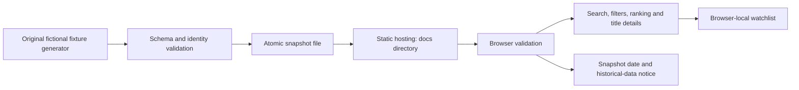

# Architecture and boundaries

The public demo and the private working app are distinct systems. This repository operates without private credentials, live-provider requests or account-based personalization.

## Public request model

The browser requests HTML, local CSS/JS, the bundled JSON snapshot and original SVG files from the same site. Navigation, filtering, saved selections and the failure exercise require no further backend requests. GitHub links are opened only when a reviewer chooses to inspect the code.

The browser validates the snapshot before rendering. On first-load failure, it shows an unavailable state and a retry button rather than presenting an empty or fabricated successful catalog. Browser storage failures degrade to session-only selection, with an explicit message.

## Snapshot publication

`pipeline/build.py` reads the source and validates it in memory, then serializes deterministically. Only after that succeeds does it create a temporary file beside the destination, flush it, and atomically replace the destination. Validation failure leaves the destination unchanged. The returned SHA-256 identifies the exact published bytes.

This design supports one snapshot file. It does not imply exactly-once ingestion, distributed transactions, a multi-file atomic release or crash durability across every filesystem failure. A production ingestion system would additionally need provider contracts, checkpoints, identity/version rules, rate limits and reconciliation appropriate to its actual sources.

## Failure exercise versus actual recovery test

The **UI exercise** sets a local degraded flag and retains the already loaded fixture. It makes no real provider request and must not be described as a production outage or live health monitor.

The **Python regression test** actually attempts to publish invalid input over a known-good temporary file and asserts that its original bytes remain unchanged. These are complementary but distinct evidence.

## Potential next steps

Provider adapters, scheduled refreshes, backend APIs and infrastructure metrics are production-app concerns described in provenance. They are not copied or exposed here. If added to a public product, they would require separately scoped credentials, data redistribution review, monitoring, deployment controls and measured service targets. No secrets should be placed in browser code or GitHub Pages.

## Optional local API

`examples/catalog_service.py` is a separately runnable, read-only reference service bound to loopback. It caches validated snapshots by file version, returns weak ETags for compressed/uncompressed equivalent responses and supports gzip negotiation. On a bad replacement, it can retain the last validated data but explicitly marks the source degraded. A cold invalid source returns503. Health and readiness endpoints measure different boundaries. It is not part of the hosted static demo, a full RFC-compliant HTTP cache, a production server hardening guide or proof of live provider freshness.
